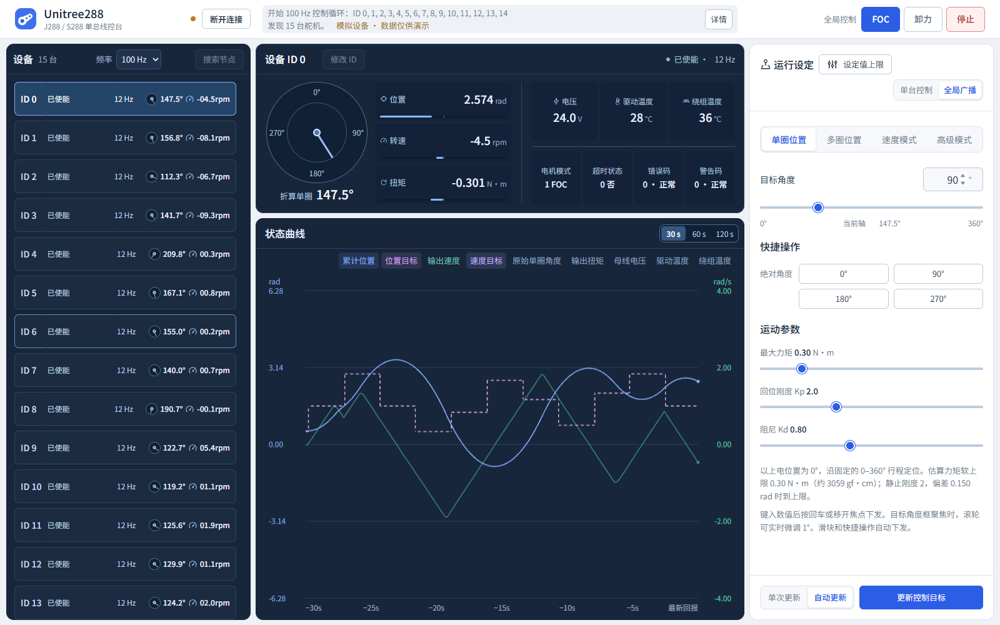

# Unitree288 单总线调试台

**[打开在线调试台 · Open the live console](https://antoniofrog.github.io/unitree288/)**

Unitree288 是面向宇树 J288 / S288 舵机的浏览器调试工具。通过 USB 单总线转接板，你可以在同一个页面上发现舵机、调整目标值，并观察舵机的实际响应。手边没有设备时，也可以用「模拟体验」试用调试台。

Unitree288 is a browser-based console for Unitree J288 and S288 servos. Connect a servo through its USB bus adapter in desktop Chrome or Edge to scan devices, adjust targets, and view live feedback. To try it without hardware, open the live console and select **模拟体验** (Simulation).



## 可以用它做什么

- **检查总线上的设备。** 扫描已连接的舵机，按 ID 查看反馈。遇到设备无响应或通信不稳定时，可在「详情」中查看超时、CRC 错误和操作日志。
- **调试单台或多台舵机。** 用「单台控制」调整指定舵机，也可以向总线广播目标。支持 FOC 控制、卸力采样和停止。
- **观察运动响应。** 调整目标后，在实时曲线上观察反馈变化，并查看各设备的角度、转速和回报频率。

## 开始体验

用桌面版 Chrome 或 Edge 打开调试台。首次使用可以先点「模拟体验」，选中一个模拟节点，调整目标并观察曲线。

连接实机时，先固定舵机、支撑负载，按型号要求供电，并用 USB 将单总线转接板接到电脑。点击「连接设备」，在浏览器中选择转接板的总线串口。扫描成功后会以零输出进入 FOC。建议从「单台控制」开始，核对 ID 后小幅调整目标。结束时点击「停止」，确认停机后再断开连接。

<a id="local-demo"></a>

## 在本机运行

仓库中包含可直接运行的网页、JavaScript 模块和字体，无需构建。下载并解压仓库后，在包含 `index.html` 的目录用 Python 3 启动静态服务：

```sh
python -m http.server 8000 --bind 127.0.0.1
```

在浏览器打开 [本地调试台](http://127.0.0.1:8000/)。模拟体验和 USB 串口连接都可以在本机使用。

## 许可证

项目自有代码采用 [MIT License](LICENSE)，版权归 ZhengChunYang (izcy.cc) 所有。

界面随附 Noto Sans SC 可变字体子集，由站点本地加载。字体采用 SIL Open Font License 1.1。[字体来源](https://github.com/google/fonts/tree/main/ofl/notosanssc) · [字体许可证](assets/font/OFL.txt)
